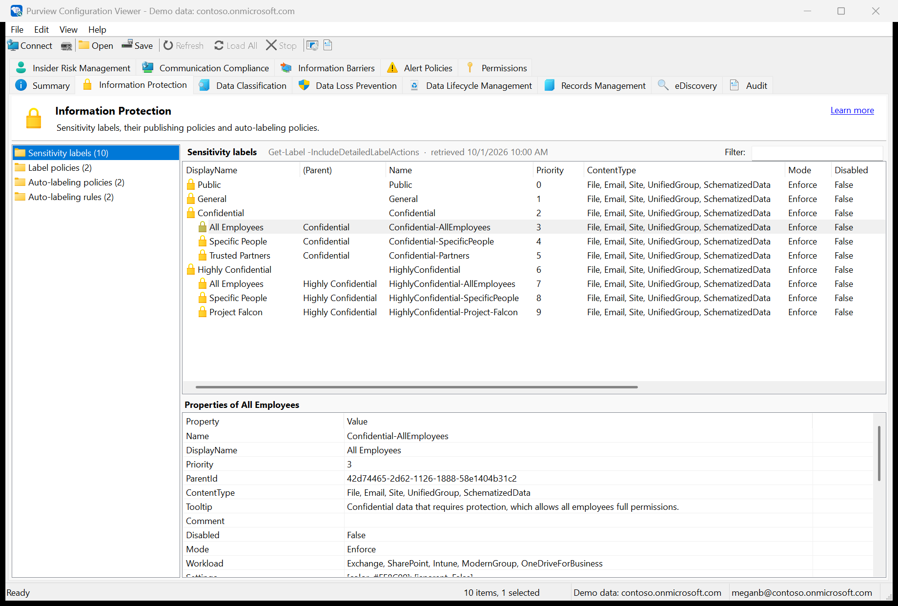
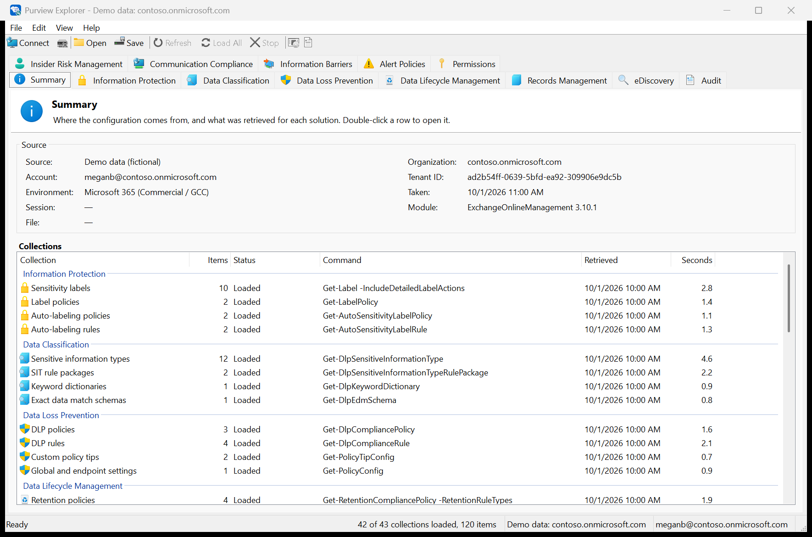
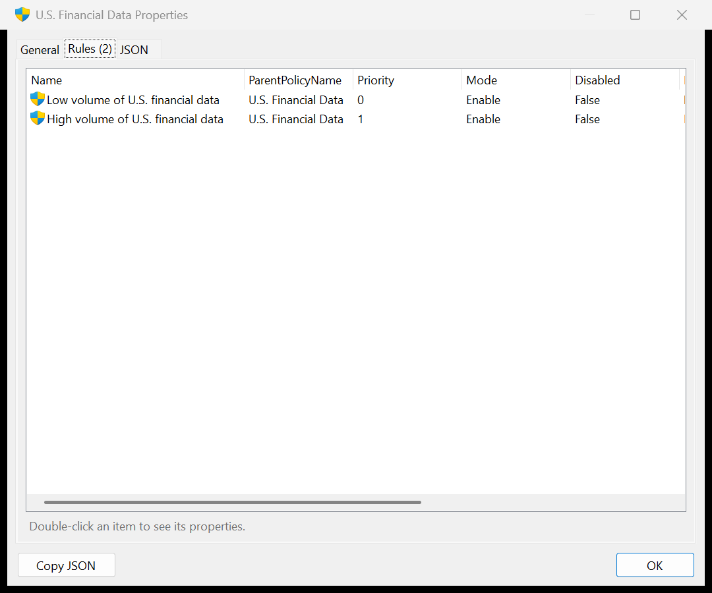
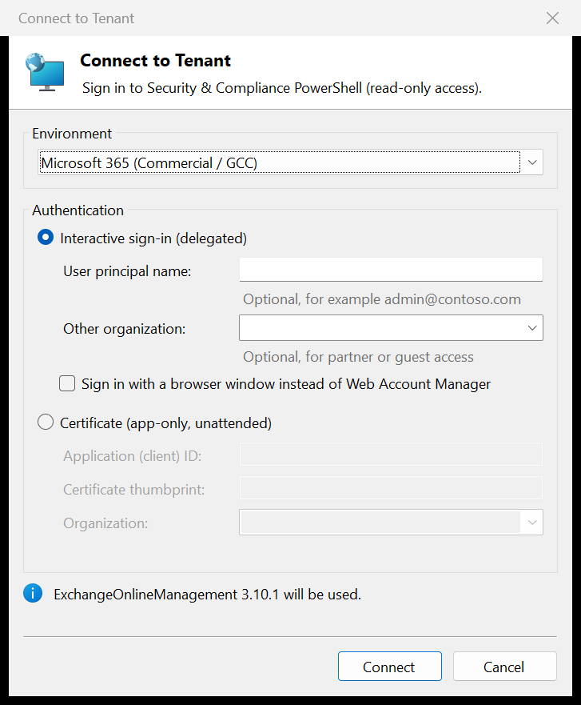
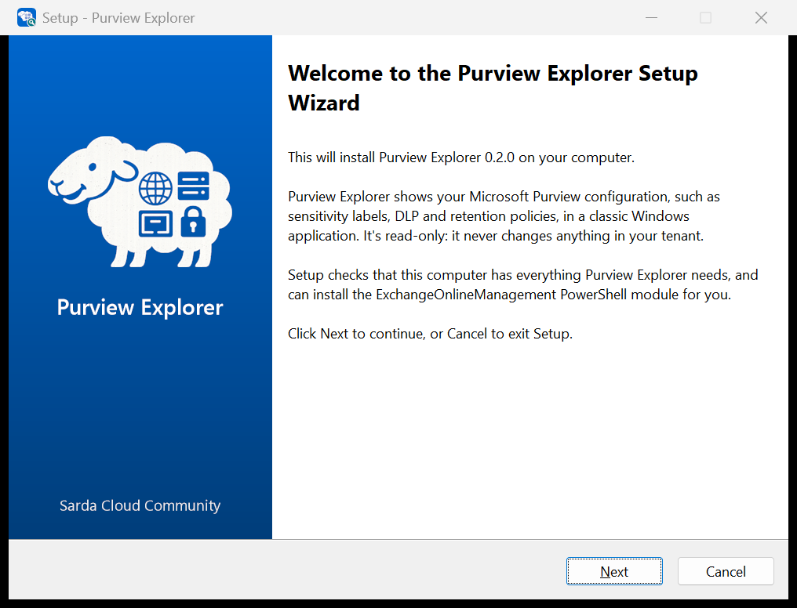
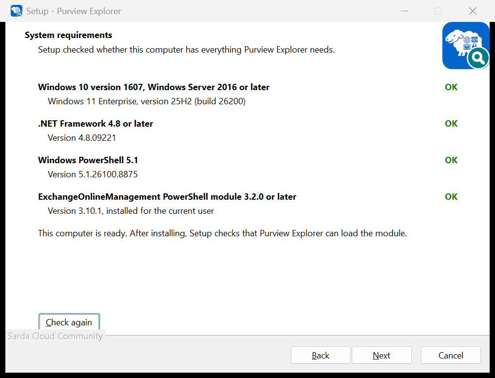
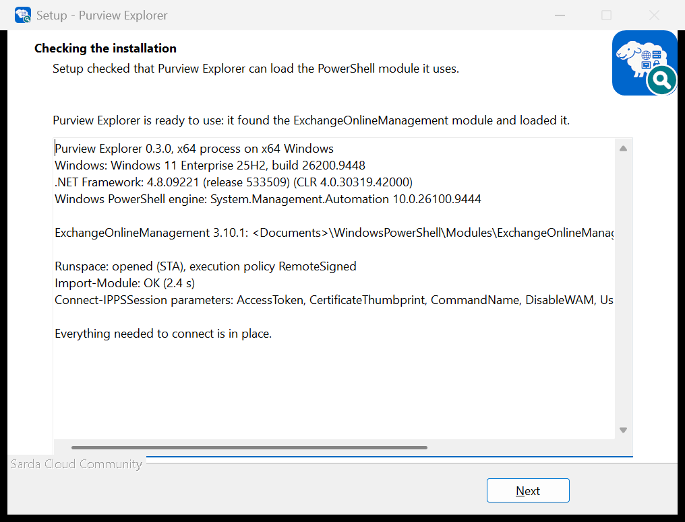

<p align="center">
  
</p>

<h1 align="center">Purview Explorer</h1>

<p align="center">
  <b>Microsoft Purview configuration in a classic Windows application, one tab per solution.</b><br>
  Sensitivity labels, DLP, retention, records, eDiscovery, audit, insider risk, communication compliance and information barriers, read-only.
</p>

<p align="center">
  <a href="https://github.com/SardaCloud/PurviewExplorer/actions/workflows/build.yml"></a>
  <a href="https://github.com/SardaCloud/PurviewExplorer/releases/latest"></a>
  <a href="LICENSE"></a>
</p>

<p align="center">
  <a href="https://www.sardacloud.com">
    <picture>
      <source media="(prefers-color-scheme: dark)" srcset="assets/sardacloud-logo-white.png">
      
    </picture>
  </a>
</p>

<p align="center">A <b>Sarda Cloud Community</b> project by Francesco Valerio Buccoli. Licensed under the <a href="LICENSE">MIT License</a>.</p>

---



## Why

The Microsoft Purview portal shows each policy on its own page, a few clicks deep, and some settings (DLP
advanced rules, label actions, endpoint DLP settings, file plan metadata) only through PowerShell. Reviewing a
tenant's configuration, or comparing it with last month's, means a lot of clicking or a lot of scripting.

Purview Explorer reads the configuration with the **read-only `Get-*` cmdlets** of Security &
Compliance PowerShell and shows it in a familiar Windows application: menu bar, toolbar, a tab per solution,
list views, property sheets and a status bar. It **never changes anything** in the tenant; the session layer
refuses to run any cmdlet that doesn't start with `Get-`.

- **Everything in one place.** 12 solutions, 43 kinds of configuration object, with the relations between them.
- **Offline snapshots.** Save the whole configuration to a diff-friendly JSON file and open it later, anywhere.
- **A setup that checks everything.** It checks the requirements, installs the PowerShell module if it's
  missing, and confirms that Purview Explorer can load it. Or skip the setup: it's one 400 KB executable.
- **Native on x64 and Arm64.** Separate builds for Intel/AMD PCs and for Windows 11 on Arm.

## Features

- **A tab per solution**: Information Protection, Data Classification, Data Loss Prevention, Data Lifecycle
  Management, Records Management, eDiscovery, Audit, Insider Risk Management, Communication Compliance,
  Information Barriers, Alert Policies and Permissions, plus a **Summary** tab.
- Each tab lists its **collections** (for example *DLP policies*, *DLP rules*, *Global and endpoint settings*),
  the **items** of the selected collection and the **properties** of the selected item.
- **Properties dialog** (double-click or Alt+Enter) with all properties, **related items** (a policy's rules, a
  label's sublabels, a case's holds) and the raw **JSON**.
- **Value viewer** (double-click a property): embedded JSON (label actions, advanced DLP rules) and XML (rule
  packages, EDM schemas) are pretty-printed.
- Sensitivity labels are shown as a **hierarchy** (sublabels indented under their parent).
- **Filter** box that searches every property of every item, not just the visible columns.
- Collections load **on demand** when you open a tab; *Load All* (Ctrl+L) retrieves everything. Collections your
  account can't read are marked *not available* instead of failing the whole view.
- **Snapshots**: save everything to an indented JSON file and open it later, offline, on any machine, without
  signing in. Snapshots are stable and diff-friendly, so you can compare configurations over time.
- **Export to CSV** (Excel-friendly; formula injection is neutralized).
- **Demo data** (File > Open Demo Data): a fictional *Contoso* tenant for trying the application.
- Sign-in with **Web Account Manager**, a **browser window**, or **certificate-based app-only** authentication;
  Commercial/GCC, GCC High, DoD and 21Vianet environments.
- **Many organizations, one account**: partners (CSP or GDAP) and guests connect to another organization by
  entering its domain; the organizations you used are remembered. See [Other organizations](#other-organizations-partners-and-guests).

| Summary | Properties dialog | Connect |
|---|---|---|
|  |  |  |

## Download and install

From the [latest release](https://github.com/SardaCloud/PurviewExplorer/releases/latest), pick the build for the
PC you'll run it on: **x64** for Intel and AMD processors (almost all PCs and servers), **arm64** for Windows 11
on Arm (for example Snapdragon-based PCs). Not sure? *Settings > System > About > System type* says
"x64-based processor" or "ARM-based processor".

| Download | What it is |
|---|---|
| `PurviewExplorer-<version>-win-x64-setup.exe`<br>`PurviewExplorer-<version>-win-arm64-setup.exe` | **Recommended.** A setup wizard that checks the requirements and can install what's missing |
| `PurviewExplorer-<version>-win-x64.zip`<br>`PurviewExplorer-<version>-win-arm64.zip` | `PurviewExplorer.exe`: unzip it anywhere and run it; install the PowerShell module yourself (see [Requirements](#requirements)) |

Each setup refuses to run on the other architecture. Neither the setups nor the executables are code-signed, so
Windows SmartScreen may warn the first time; choose **More info > Run anyway**, or build them yourself.
`SHA256SUMS.txt` in each release lists their SHA-256 hashes.

### What the setup does

| Welcome | System requirements | Checking the installation |
|---|---|---|
|  |  |  |

1. Asks whether to install **for you only** (the default, no administrator rights needed, into
   `%LOCALAPPDATA%\Programs\Sarda Cloud\Purview Explorer`) or **for all users** (into Program Files).
2. **Checks the requirements** and shows what it found: Windows, .NET Framework, Windows PowerShell 5.1 and the
   ExchangeOnlineManagement module 3.2.0 or later (see [Requirements](#requirements)). It won't continue without
   the first three, which are part of current Windows versions.
3. If the module is missing or too old, offers to **install it from the PowerShell Gallery** (selected by
   default): for the current user, or for all users when installing for all users.
4. Installs Purview Explorer with a Start menu shortcut (and, if you choose, a desktop shortcut) and an entry
   in **Installed apps** for uninstalling.
5. **Checks the installation**: it runs `PurviewExplorer.exe /CheckPrerequisites`, which loads the module in the
   application exactly as signing in would, and shows the result.

Uninstalling removes the application and its shortcuts. It leaves your settings and the PowerShell module,
which other tools may use.

Setup supports the usual [Inno Setup command-line switches](https://jrsoftware.org/ishelp/topic_setupcmdline.htm)
for unattended installs, for example (with the x64 setup):

```text
PurviewExplorer-<version>-win-x64-setup.exe /VERYSILENT /CURRENTUSER                         install for the current user
PurviewExplorer-<version>-win-x64-setup.exe /VERYSILENT /ALLUSERS                            install for all users (elevated)
PurviewExplorer-<version>-win-x64-setup.exe /VERYSILENT /MERGETASKS="!installmodule"         don't install the module
PurviewExplorer-<version>-win-x64-setup.exe /VERYSILENT /LOG="C:\Temp\PurviewExplorer.log"   write a log, including the checks
```

A silent install stops if Windows, .NET Framework or Windows PowerShell 5.1 is missing. The log records every
check and the result of the installation check.

## Requirements

| | x64 | arm64 |
|---|---|---|
| Windows | Windows 10 version 1607 or later, Windows 11, Windows Server 2016 or later | Windows 11 on Arm |
| .NET Framework | 4.8 or later (built into Windows 10 version 1903 and later) | 4.8.1 or later (built into Windows 11 version 22H2 and later) |
| Windows PowerShell | 5.1 (built in) | 5.1 (built in) |

- The **ExchangeOnlineManagement** PowerShell module, version 3.2.0 or later. The setup can install it for you;
  otherwise:

  ```powershell
  Install-Module ExchangeOnlineManagement -Scope CurrentUser
  ```

  The module is found whether it was installed for Windows PowerShell or PowerShell 7. *Help > Check
  Prerequisites* verifies that it loads, without signing in. Its report replaces your own folders (which contain
  your user name) with placeholders such as `<Documents>`, so you can paste it into an issue.
- An account with permission to read the Purview configuration of the organization you connect to, for example a
  member of the *Compliance Administrator* or *Organization Management* role group (or, for a partner, a GDAP
  relationship with a role that includes it). Some collections need specific roles (eDiscovery,
  Insider Risk Management, Communication Compliance); without them those collections show as *not available*.

## Usage

1. **File > Connect to Tenant**, choose the environment and the sign-in method, and sign in. To connect to an
   organization other than your account's own, enter it under *Other organization*.
2. Pick a tab. Its collections load in the background; select a collection to see its items.
3. Select an item to see its properties, or double-click it for the full property sheet.
4. **File > Save Snapshot** to keep a copy you can open later with **File > Open Snapshot**.

| Key | Action |
|---|---|
| F5 | Refresh the selected collection |
| Shift+F5 | Refresh every collection of the tab |
| Ctrl+L | Load all collections |
| Ctrl+F5 | Refresh all collections |
| Ctrl+F | Filter the list |
| Alt+Enter, Enter | Properties of the selected item |
| Ctrl+C | Copy the selected rows (tab-separated) |
| Ctrl+E | Export the list to CSV |
| Ctrl+O / Ctrl+S | Open / save a snapshot |

Command line:

```text
PurviewExplorer.exe [snapshot.json]                  open a snapshot
PurviewExplorer.exe /Demo                            open the demo data
PurviewExplorer.exe /CheckPrerequisites[:report.txt] check that the module loads, without signing in; with a file name,
                                                     write the report there instead of showing it (exit code 0 = ready)
PurviewExplorer.exe /SelfTest:log.txt                drive the UI with the demo data and write PASS/FAIL lines (exit code 0 = all passed)
```

### Sign-in options

- **Interactive** (default): the module signs in with Web Account Manager (WAM). If WAM isn't usable from the
  application, it automatically falls back to a browser window; you can also choose the browser directly.
- **Certificate (app-only)**: application ID, certificate thumbprint (CurrentUser\My or LocalMachine\My) and the
  organization's `*.onmicrosoft.com` domain. See
  [App-only authentication for unattended scripts](https://aka.ms/exo-cba) for setting up the app registration
  and assigning it a Purview role. A multi-tenant app registration, consented in each organization, reaches
  several organizations with the same certificate: change the organization.

### Other organizations (partners and guests)

An account can have access to the Purview configuration of organizations other than its own:

- a **partner** account (`alex@contoso.com`) managing **customer organizations** through the Cloud Solution
  Provider program or granular delegated admin privileges (GDAP);
- a **guest** account invited into another organization and given a Purview role there.

Choose *Interactive sign-in*, enter the account and, under **Other organization**, the other organization's
`*.onmicrosoft.com` domain (for example `adatum.onmicrosoft.com`). Purview Explorer signs in at that organization
and maps the session to it, which is what Microsoft documents for
[connecting to customer organizations](https://learn.microsoft.com/powershell/exchange/connect-to-scc-powershell#connect-to-security--compliance-powershell-in-customer-organizations):

```powershell
Connect-IPPSSession -UserPrincipalName alex@contoso.com -DelegatedOrganization adatum.onmicrosoft.com `
    -AzureADAuthorizationEndpointUri https://login.microsoftonline.com/adatum.onmicrosoft.com
```

In GCC High and DoD the sign-in address is `login.microsoftonline.us`, in 21Vianet `login.chinacloudapi.cn`.
Leave *Other organization* empty for the account's own organization.

The title bar, the status bar, the Summary tab and saved snapshots name the organization you connected to; the
account shows who signed in. Each other organization, and each certificate organization, you connect to
successfully is added to a list of the ten most recent ones, offered in both organization boxes. Connecting again
first disconnects the current session, so only one organization is connected at a time; to compare organizations,
save a snapshot of each.

Settings (last environment, account, other organization, app ID, thumbprint, recent organizations, window
position) are saved in `%APPDATA%\SardaCloud\PurviewExplorer\settings.json`. No passwords, tokens or keys are
stored.

## What is retrieved

| Solution | Collection | Command |
|---|---|---|
| Information Protection | Sensitivity labels | `Get-Label -IncludeDetailedLabelActions` |
| Information Protection | Label policies | `Get-LabelPolicy` |
| Information Protection | Auto-labeling policies | `Get-AutoSensitivityLabelPolicy` |
| Information Protection | Auto-labeling rules | `Get-AutoSensitivityLabelRule` |
| Data Classification | Sensitive information types | `Get-DlpSensitiveInformationType` |
| Data Classification | SIT rule packages | `Get-DlpSensitiveInformationTypeRulePackage` |
| Data Classification | Keyword dictionaries | `Get-DlpKeywordDictionary` |
| Data Classification | Exact data match schemas | `Get-DlpEdmSchema` |
| Data Loss Prevention | DLP policies | `Get-DlpCompliancePolicy` |
| Data Loss Prevention | DLP rules | `Get-DlpComplianceRule` |
| Data Loss Prevention | Custom policy tips | `Get-PolicyTipConfig` |
| Data Loss Prevention | Global and endpoint settings | `Get-PolicyConfig` |
| Data Lifecycle Management | Retention policies | `Get-RetentionCompliancePolicy -RetentionRuleTypes` |
| Data Lifecycle Management | Retention rules | `Get-RetentionComplianceRule` |
| Data Lifecycle Management | App retention policies | `Get-AppRetentionCompliancePolicy` |
| Data Lifecycle Management | App retention rules | `Get-AppRetentionComplianceRule` |
| Data Lifecycle Management | Adaptive scopes | `Get-AdaptiveScope` |
| Records Management | Retention labels | `Get-ComplianceTag` |
| Records Management | Event types | `Get-ComplianceRetentionEventType` |
| Records Management | Events | `Get-ComplianceRetentionEvent` |
| Records Management | File plan: departments | `Get-FilePlanPropertyDepartment` |
| Records Management | File plan: categories | `Get-FilePlanPropertyCategory` |
| Records Management | File plan: subcategories | `Get-FilePlanPropertySubCategory` |
| Records Management | File plan: authorities | `Get-FilePlanPropertyAuthority` |
| Records Management | File plan: citations | `Get-FilePlanPropertyCitation` |
| Records Management | File plan: reference IDs | `Get-FilePlanPropertyReferenceId` |
| eDiscovery | Cases (Standard) | `Get-ComplianceCase` |
| eDiscovery | Cases (Premium) | `Get-ComplianceCase -CaseType AdvancedEdiscovery` |
| eDiscovery | Case holds | `Get-CaseHoldPolicy -Case <each case>` |
| eDiscovery | Content searches | `Get-ComplianceSearch` |
| eDiscovery | Compliance security filters | `Get-ComplianceSecurityFilter` |
| eDiscovery | eDiscovery administrators | `Get-eDiscoveryCaseAdmin` |
| Audit | Audit retention policies | `Get-UnifiedAuditLogRetentionPolicy` |
| Audit | Audit configuration | `Get-AdminAuditLogConfig` |
| Insider Risk Management | Insider risk policies | `Get-InsiderRiskPolicy` (not publicly documented) |
| Insider Risk Management | Insider risk cases | `Get-ComplianceCase -CaseType InsiderRisk` |
| Communication Compliance | Policies | `Get-SupervisoryReviewPolicyV2` |
| Communication Compliance | Rules | `Get-SupervisoryReviewRule` |
| Information Barriers | Policies | `Get-InformationBarrierPolicy` |
| Information Barriers | Segments | `Get-OrganizationSegment` |
| Information Barriers | Application status | `Get-InformationBarrierPoliciesApplicationStatus` |
| Alert Policies | Alert policies | `Get-ProtectionAlert` |
| Permissions | Role groups | `Get-RoleGroup` |

The list is defined in [`Catalog/PurviewCatalog.cs`](src/PurviewExplorer/Catalog/PurviewCatalog.cs); adding a
collection is one entry (cmdlet, parameters, preferred columns and optional relations).

## How it works

The application hosts a Windows PowerShell 5.1 runspace in-process (on its own STA thread so the module's
sign-in UI works), imports ExchangeOnlineManagement and runs `Connect-IPPSSession` limited to the cmdlets above.
Results are converted to plain JSON-like values, which the UI, snapshots and CSV export all share. When the
application is started from PowerShell 7, PowerShell 7 module folders are removed from the process's
`PSModulePath`, so Windows PowerShell doesn't try to load PowerShell 7's copy of PackageManagement.

### Snapshot format

```json
{
  "format": "PurviewExplorer.Snapshot",
  "formatVersion": 1,
  "createdUtc": "2026-10-12T18:00:00Z",
  "source": { "kind": "Live", "organization": "contoso.onmicrosoft.com", "account": "...", "tenantId": "..." },
  "collections": {
    "DataLossPrevention.Policies": {
      "command": "Get-DlpCompliancePolicy",
      "state": "Loaded",
      "retrievedUtc": "2026-10-12T17:58:41Z",
      "items": [ { "Name": "U.S. Financial Data", "Mode": "Enable", "...": "..." } ]
    }
  }
}
```

A snapshot contains your tenant's configuration (names, addresses, conditions). Store and share it accordingly.

## Building

You need Windows and the .NET SDK (8 or later; it builds the .NET Framework project without Visual Studio).
Building the setups also needs [Inno Setup 6](https://jrsoftware.org/isinfo.php) (`winget install JRSoftware.InnoSetup`).

```powershell
.\build.ps1                         # Release build + all tests
.\build.ps1 -Package                # also artifacts\PurviewExplorer-<version>-win-x64.zip and -win-arm64.zip
.\build.ps1 -Setup                  # also artifacts\PurviewExplorer-<version>-win-x64-setup.exe and -win-arm64-setup.exe
.\build.ps1 -Setup -Arch x64        # only one architecture
.\installer\test-setup.ps1 -Setup .\artifacts\PurviewExplorer-<version>-win-x64-setup.exe   # install, check, uninstall
```

The released executables are built per architecture: x64 targets .NET Framework 4.8 and ARM64 targets .NET
Framework 4.8.1, the first version that runs natively on Arm64. `build.ps1` checks that each executable is built
for the processor it claims. The tests use the AnyCPU build.

The version comes from the `VERSION` file. The tests include an integration test that loads
ExchangeOnlineManagement in the hosted runspace (when the module is installed), one that exercises the
Connect-IPPSSession error path without network access, and one that runs `/SelfTest`, which drives every tab,
collection, properties dialog, filter and snapshot round trip. CI installs the module so all of them run.

CI also tests the setups: the x64 setup on the build machine, where the module is installed, and each setup on a
clean runner of its own architecture (Windows Server on x64, Windows 11 on Arm64) from which the module,
PowerShellGet 2 and the NuGet provider have been removed, like a freshly installed Windows. There the setup must
install the module from the PowerShell Gallery and confirm that Purview Explorer loads it.

| Script | Purpose |
|---|---|
| `installer\PurviewExplorer.iss` | The Inno Setup script: requirement checks, module installation, verification |
| `installer\test-setup.ps1` | Installs silently, checks files, shortcut, uninstall entry, checks and verification, then uninstalls |
| `installer\make-runner-clean.ps1` | Strips a CI runner down to what a freshly installed Windows has |
| `assets\make-assets.ps1` | Draws the icon, README logos and setup wizard images from the Sarda Cloud logo |
| `tools\make-demo.ps1` | Regenerates the fictional demo snapshot (`pwsh`) |

See [CONTRIBUTING.md](CONTRIBUTING.md) for how to add a collection and the rules of the house.

## Security

Please report vulnerabilities privately; see [SECURITY.md](SECURITY.md).

## License and trademarks

Purview Explorer is released under the [MIT License](LICENSE).

The Sarda Cloud name and logo are trademarks of Sarda Cloud Srl and are not licensed under the MIT License.
Microsoft, Microsoft Purview, Windows and PowerShell are trademarks of the Microsoft group of companies.
Purview Explorer is an independent community tool and is not affiliated with or endorsed by
Microsoft. The demo data describes a fictional company; any resemblance to a real organization is coincidental.

Purview Explorer was called *Purview Configuration Viewer* in its first release (0.1.0). The setup is built with
[Inno Setup](https://jrsoftware.org/isinfo.php); see [THIRD-PARTY-NOTICES.md](THIRD-PARTY-NOTICES.md).

---

A Sarda Cloud Community project. Copyright (C) 2026 Francesco Valerio Buccoli.
